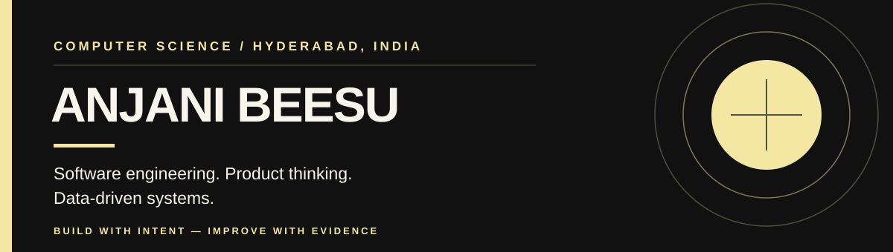

<!-- Visual identity: monochrome black and white. -->

  

  <a href="https://www.linkedin.com/in/anjanibeesu/">LINKEDIN</a>
  &nbsp; <strong>／</strong> &nbsp;
  <a href="https://portfolio-theta-olive-54.vercel.app/">PORTFOLIO</a>
  &nbsp; <strong>／</strong> &nbsp;
  <a href="mailto:anjanibeesu@gmail.com">EMAIL</a>

---

## 01 / Education

**B.Tech · Computer Science Engineering (CSE)**  
2025 – 2029 &nbsp; · &nbsp; CGPA: 8.80

## 02 / Tech Stack I Work With

| **Discipline** | **Tools and technologies** |
|:--|:--|
| **Languages** | Python · Java · C · SQL · JavaScript · TypeScript |
| **Frontend** | React · Next.js · HTML · CSS |
| **Backend** | Node.js · Flask · REST APIs |
| **Data** | MySQL · relational data modeling · data analysis |
| **Applied AI** | LLM integration · RAG · tool calling · prompt-injection testing |
| **Engineering** | Git · GitHub · Docker · Vercel |

## 03 / Selected projects

<table>
  <tr>
    <td bgcolor="#FFFFFF" width="235"><strong><a href="https://github.com/AnjaniBeesu/STUKO">STUKO ↗</a></strong></td>
    <td>Student study platform · Next.js · Firebase Authentication</td>
  </tr>
  <tr>
    <td bgcolor="#FFFFFF"><strong><a href="https://github.com/AnjaniBeesu/space">The Space ↗</a></strong></td>
    <td>Interactive solar system · ISS tracking API</td>
  </tr>
  <tr>
    <td bgcolor="#FFFFFF"><strong><a href="https://github.com/AnjaniBeesu/Pathloom">Pathloom ↗</a></strong></td>
    <td>Student productivity · Personalized learning</td>
  </tr>
  <tr>
    <td bgcolor="#FFFFFF"><strong><a href="https://github.com/AnjaniBeesu/Prompt-injection-playground">Prompt Injection Playground ↗</a></strong></td>
    <td>AI security testing · Risk scoring · Defense evaluation</td>
  </tr>
  <tr>
    <td bgcolor="#FFFFFF"><strong><a href="https://github.com/AnjaniBeesu/CRICKO">CRICKO ↗</a></strong></td>
    <td>Cricket analytics · RAG · Match data</td>
  </tr>
  <tr>
    <td bgcolor="#FFFFFF"><strong><a href="https://github.com/AnjaniBeesu/AI-invoice-processing-agent">AI Invoice Processing Agent ↗</a></strong></td>
    <td>Document extraction · Validation · Workflow automation</td>
  </tr>
</table>

## 04 / GitHub stats

  
  

## 05 / Certification

**Python for Data Science, AI & Development — IBM**  
[Verify certificate](https://www.coursera.org/account/accomplishments/verify/3XOBG399VIG7)

---

<table>
  <tr>
    <td bgcolor="#111111">
      
<strong>CONNECT WITH ME</strong>

      
I’m open to internships, early-career opportunities, and project collaborations. Feel free to reach out if you’d like to work together or discuss an idea.

      

        <a href="https://www.linkedin.com/in/anjanibeesu/">LinkedIn</a>
        &nbsp; / &nbsp;
        <a href="mailto:anjanibeesu@gmail.com">anjanibeesu@gmail.com</a>
      

    </td>
  </tr>
</table>

BUILD WITH INTENT. ENGINEER WITH RIGOR. IMPROVE WITH EVIDENCE.

